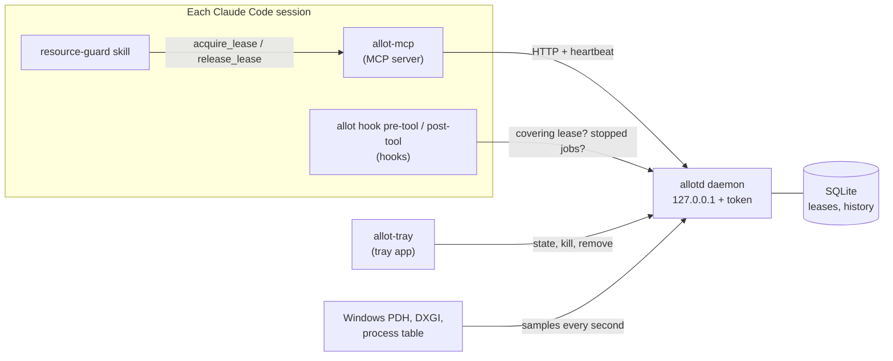

<h1>
  <picture>
    <source media="(prefers-color-scheme: dark)" srcset="assets/brand/png/allot-mark-color-dark-2x.png">
    
  </picture>
  Allot
</h1>

[](https://github.com/meh7an/allot/actions/workflows/ci.yml)
[](https://github.com/meh7an/allot/releases/latest)
[](#license)


Coordinates CPU and GPU heavy work between the Claude Code sessions on one Windows PC. Sessions
ask a per-user daemon for a lease before a build, test suite, benchmark, or training run, and
wait their turn when the machine is busy, instead of all compiling at once. A tray app shows
every session's jobs and lets you stop one; the session is told and asks you what to do next.

## Why

Run three or four Claude Code sessions on one machine and they will, sooner or later, all start
`cargo build`, a test suite, or a training run in the same minute. Each job then takes several
times longer, RAM runs out, tool calls time out, and any timing a session measures is noise.
None of the sessions can see the others.

Allot gives them a shared view of the machine and a ledger of who is using what. A session
reserves the cores, RAM, GPU, and VRAM a job needs before running it; when they are not
free, it waits in a queue and is told what is ahead and roughly how long.

## How it works



| Part | What it does |
|------|--------------|
| `allotd` | The daemon: samples the machine every second, keeps the lease ledger in SQLite, and serves an HTTP API on `127.0.0.1` with a bearer token. No window; it logs to a file. |
| `allot-mcp` | The MCP server each session starts (`allot`): `system_snapshot`, `can_fit`, `acquire_lease`, `release_lease`, `list_leases`. It heartbeats its leases and releases them when the session ends. |
| `allot hook pre-tool` | A PreToolUse hook for the Bash and PowerShell tools. It denies a heavy command when the session holds no covering lease, and lets it through with a warning when allotd is down. |
| `allot hook post-tool` | A PostToolUse and PostToolUseFailure hook that tells the session when you stopped its job. |
| `allot-tray` | The tray app: an icon that shows how busy the machine is, and a flyout with every session's jobs, Kill and Remove, resource meters, and toasts. Only a client of allotd. |
| `resource-guard` skill | Tells Claude when and how to lease. A CLAUDE.md rule points sessions to it. |
| `allot` | The CLI: status, leases, history, kill, remove, daemon control, install. |

What the daemon does with a request:

- **Admission.** A lease is granted when its profile fits in what the machine has free, keeping
  a headroom (15% by default). Otherwise it queues; smaller jobs may backfill ahead of a
  queued one only when that does not delay it, so nothing starves.
- **Learned profiles.** Every released lease records what the job really used. The next run
  of the same command in the same folder is estimated from that history, not only from what
  the session declared.
- **Benchmarks.** A `benchmark_exclusive` lease drains the machine and waits for it to stay
  quiet before it is granted, so measurements are not disturbed. The background noise during
  the run is recorded on release.
- **Liveness.** Leases are kept alive by heartbeats and tied to the session's process. A
  session that ends or crashes loses its leases within a second or two, so they never leak.
- **Fail-open.** If allotd is down, the hook lets commands run with a warning instead of
  blocking every shell call.

Windows only. Everything lives in `%USERPROFILE%\.allot\`, not under `AppData`,
because the Claude desktop app is MSIX-packaged and Windows redirects its writes to `AppData`
into a folder that terminal sessions cannot see.

## Install

Needs Windows 10 or 11 (x64) and Claude Code. No admin rights: everything is installed for
your user only.

1. Download `allot-<version>-setup.exe` from the
   [latest release](https://github.com/meh7an/allot/releases/latest) and run
   it. Close the Claude sessions you have open first if you can: the setup edits their
   settings and CLAUDE.md. The setup is not code-signed, so SmartScreen may ask you to confirm
   (More info, Run anyway).
2. Keep both choices on the Select Additional Tasks page, unless you want to set up Claude
   Code yourself or start the tray app by hand.
3. Start a new Claude session (sessions load MCP servers and CLAUDE.md only when they start).

The setup:

- puts `allot.exe`, `allotd.exe`, and `allot-mcp.exe` in `%USERPROFILE%\.allot\bin`,
  restarts allotd on them when it is running, and registers the `allot` scheduled task
  that starts allotd when you sign in (no time limit, also on battery);
- puts the tray app in `bin\tray`, starts it, sets its Launch at logon, and adds it to the
  Start menu;
- copies the `resource-guard` skill to `~/.claude/skills/resource-guard/`;
- registers the MCP server at user scope, with `claude mcp add` when `claude` is on `PATH` and
  otherwise in `~/.claude.json` directly;
- adds the PreToolUse, PostToolUse, and PostToolUseFailure hooks to `~/.claude/settings.json`;
- writes the rule to `~/.claude/allot.md` and imports it into `~/.claude/CLAUDE.md`
  with the line `@allot.md`. A copy of the rule pasted by hand before is replaced
  by that line;
- adds Allot to Apps & features, for uninstalling.

A file is only rewritten when something in it changes, and the old one is kept beside it as
`<name>.allot-backup`. What the setup did is in `%LOCALAPPDATA%\Programs\Allot\install.log`.

Check it with:

```powershell
~\.allot\bin\allot.exe status
claude mcp get allot
```

To type `allot` anywhere, add `%USERPROFILE%\.allot\bin` to your user `PATH`
(optional; the examples below assume it).

### Without the setup

The release also has `allot-<version>-x86_64-pc-windows-msvc.zip`. Extract it and
run `allot.exe install` from that folder: it does everything the setup does except the Start
menu and Apps & features entries, and prints `[done]` for each step, or `[todo]` with what to
do by hand when a step could not be done. `allot install --help` lists its options
(`--no-claude`, `--no-logon-task`, `--launch-at-logon on|off`).

To build from source you need Rust (stable, MSVC toolchain, 1.99 or newer), and for the tray
app the .NET 10 SDK and Visual Studio's C++ build tools (the Native AOT linker). Inside a
Claude session each build is a `cpu_heavy` lease like any other.

```powershell
cargo build --release
dotnet publish tray\src\Allot.Tray -c Release -o target\release\tray
target\release\allot.exe install
```

The publish finds the linker through `vswhere.exe`; if it cannot, add
`C:\Program Files (x86)\Microsoft Visual Studio\Installer` to `PATH`. The setup itself is
built from `installer\allot.iss` with Inno Setup 7 (see the script's header).

## Usage

Once installed there is nothing to call by hand: the skill and the CLAUDE.md rule make each
session lease before a heavy command, and the hook stops the ones that forget. A typical
exchange inside a session:

1. Claude is about to run `cargo test --workspace`, so it calls `acquire_lease` with the class
   `cpu_heavy` and the command as label.
2. The machine is busy with another session's build, so the lease comes back `queued` with what
   is ahead and an estimated wait. Claude tells you in one line and waits.
3. The other build's lease is released; this one is granted, the tests run, and Claude calls
   `release_lease`.

The classes are `light`, `cpu_heavy`, `gpu_heavy`, and `mixed`; timing work adds the lease
kind `benchmark_exclusive`. `allot classes` prints the class profiles and the rules that decide
which commands count as heavy.

### Everyday commands

| Command | Shows or does |
|---------|---------------|
| `allot status` | Machine usage, sessions, and their leases. Starts allotd if it is down. |
| `allot leases [--all]` | Active and queued leases, or the most recent ones in any state. |
| `allot history [FINGERPRINT]` | What past jobs needed, or the runs of one job. |
| `allot classes` | The heavy-command rules, class profiles, and presets in effect. |
| `allot kill ID` / `allot remove ID` | Stop a running job, or take a queued one out of the queue, as the tray app does. |
| `allot daemon start\|stop\|status` | Control allotd. `status` never starts it. |

### The tray app

The icon in the notification area shows whether the machine is idle, busy, or has jobs
waiting. Click it for the flyout:

- **Jobs.** Each running or queued job with its process, command, class, time, and estimate;
  a bar fills toward the estimate. Finished and stopped jobs stay for a moment with how they
  ended.
- **Kill** (running jobs) and **Remove** (queued ones) ask once more (Kill?) before they act.
  Kill ends only the process tree the lease's command started: never Claude Code itself,
  allotd, allot, allot-mcp, or a process older than the command. The lease ends and its session is
  told that you stopped the job, so Claude says so and asks you whether to retry or skip; it
  never retries on its own.
- **Benchmarks** show their phase: draining the machine, waiting for quiet, running alone.
- **Resources** (More options, Meters) shows CPU, RAM, GPU, VRAM, and drives, with what is
  used, reserved by leases, and free.
- **Toasts** for a stopped service, a job running well past its estimate, finished jobs, and
  jobs stopped from outside the flyout; each can be turned off under More options.
- **Stay open** and **Pin** keep the flyout up; a pinned flyout can be dragged.

The tray menu starts and stops allotd and turns Launch at logon on or off (it is also listed in
Task Manager's Startup apps as Allot). Stop service only lasts until a session's
`allot-mcp` needs allotd again and starts it. The tray app keeps its settings in `tray.json` and
logs to `logs\tray.log`.

## Configuration

`%USERPROFILE%\.allot\config.toml` is optional. Each table overrides the defaults
field by field, unknown keys are rejected, and allotd reloads the file within 5 s. The common
keys:

```toml
[admission]
headroom_pct = 15          # capacity kept free of leases

[hook]
fail_open = true           # let commands run when allotd is down

[benchmark]
max_quiet_wait_secs = 60   # grant a benchmark without quiet after this long
```

Every key, the class profiles, and the classifier rules are in the
[runbook](docs/runbook.md#configuration).

## Upgrade

Run the new setup over the old install (or `allot.exe install` from a new zip or build). Binaries
that running sessions hold open cannot be overwritten, so the old file is renamed aside
(`allot-mcp.old-<millis>.exe`) and the new one copied in. Old copies that are still in use are
deleted by the next install. allotd restarts on the new build and restores its active and queued
leases. Open sessions keep their old `allot-mcp` until they restart. The hook picks up the new
`allot.exe` at once.

The tray app is asked to quit, replaced, and started again. The setup remembers your choices
from the last time; `allot install` without `--launch-at-logon` keeps Launch at logon as you set
it. The rule in `~/.claude/allot.md` is rewritten, and CLAUDE.md keeps its import.

Allot used to be called Resources Helper. Its setup, or `allot install`, takes over a
Resources Helper install: it copies the database, token, config, tray settings, and logs from
`%USERPROFILE%\.resources-helper\` into `%USERPROFILE%\.allot\`, replaces the logon task, the
tray app's Launch at logon, the Start menu entry, the MCP server (now `allot`), the hooks, and
the CLAUDE.md import (now `@allot.md`), and removes the old binaries. allotd keeps the old port
and token, so sessions that were open keep their old MCP server working until they restart.
The old folder is deleted by a later install once nothing runs from it.

## Uninstall

Uninstall Allot in Settings > Apps > Installed apps. It asks whether to delete your
data too, then quits and removes the tray app with its Launch at logon entry and Start menu
shortcut, removes the MCP server, the hooks, the CLAUDE.md import, and the scheduled task,
stops allotd, and removes the binaries and the skill copy. A copy of the rule pasted into
CLAUDE.md by hand is left for you to delete.

Without the setup, run `allot.exe uninstall` from the extracted release or the build output, not
from the bin directory (a running exe cannot delete itself). It does the same and prints what
it could not do. The database, token, config, tray settings, and logs stay unless you choose
to delete them, or pass `--purge`.

## Files

All under `%USERPROFILE%\.allot\`:

| Path | Contents |
|------|----------|
| `bin\` | `allot.exe`, `allotd.exe`, `allot-mcp.exe` |
| `bin\tray\` | The tray app, `allot-tray.exe` and its runtime. |
| `config.toml` | Optional overrides of the defaults. allotd reloads it within 5 s. |
| `allot.db` | Leases, their audit trail, and job history (SQLite, WAL). |
| `token` | The bearer token clients send to allotd. |
| `tray.json` | The tray app's settings: meters, toasts, first run. |
| `logs\allotd.log` | The daemon log, rotated at 10 MB, five files kept. |
| `logs\tray.log` | The tray app's log. |

In `~/.claude/`, the install writes `skills/resource-guard/SKILL.md` and `allot.md`
(the rule CLAUDE.md imports), and adds its entries to `settings.json` and `CLAUDE.md`.

## Troubleshooting

Health checks, fail-open behavior, crash recovery, and resetting the database are in the
[runbook](docs/runbook.md). The quickest checks:

- `allot daemon status` tells you whether allotd is up, its version, and its port.
- A heavy command "Blocked by allot" in a session without an `acquire_lease` tool
  means the session started before the MCP server was registered; start a new one.
- Every heavy command running with a "runs unchecked" warning means allotd is down; read the end
  of `logs\allotd.log`.
- No tray icon after an install: `allot install` says why. Another copy of the tray app (such as
  a development build) may hold its place; quit it from its tray menu and start
  `bin\tray\allot-tray.exe`.

## Platform support

Windows 10 and 11 on x86_64 only. The sampler reads Windows performance counters (PDH) and
DXGI for vendor-neutral GPU and VRAM usage, autostart uses a Windows logon task and the Run
key, and the tray app is a WinUI 3 app. GPU numbers cover one adapter.

## Contributing

Issues and pull requests are welcome; see [CONTRIBUTING.md](CONTRIBUTING.md). Report security
issues privately as described in [SECURITY.md](SECURITY.md). Changes are listed in
[CHANGELOG.md](CHANGELOG.md).

## License

Licensed under either of

- Apache License, Version 2.0 ([LICENSE-APACHE](LICENSE-APACHE) or
  <https://www.apache.org/licenses/LICENSE-2.0>)
- MIT license ([LICENSE-MIT](LICENSE-MIT) or <https://opensource.org/licenses/MIT>)

at your option.

Unless you explicitly state otherwise, any contribution intentionally submitted for inclusion
in the work by you, as defined in the Apache-2.0 license, shall be dual licensed as above,
without any additional terms or conditions.
