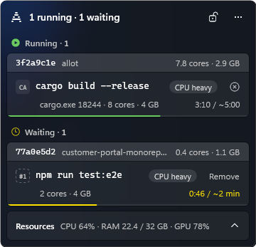
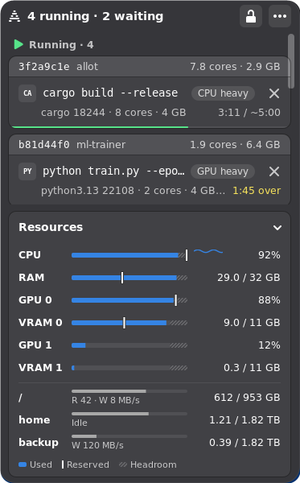

<h1>
  <picture>
    <source media="(prefers-color-scheme: dark)" srcset="assets/brand/png/allot-mark-color-dark-2x.png">
    
  </picture>
  Allot
</h1>

[](https://github.com/meh7an/allot/actions/workflows/ci.yml)
[](https://github.com/meh7an/allot/releases/latest)
[](#license)


Coordinates heavy jobs between the Claude Code sessions on one machine. Sessions ask a small local
daemon for a lease before a build, test suite, benchmark, or training run, and wait their turn when
the machine is busy, instead of all compiling at once.

<p align="center">
  
  <br>
  <sub>The Windows panel, showing sample jobs.</sub>
</p>

## Why

Run three or four Claude Code sessions on one machine and they will, sooner or later, all start
`cargo build`, a test suite, or a training run in the same minute. Each job then takes several
times longer, RAM runs out, tool calls time out, and any timing a session measures is noise.
None of the sessions can see the others.

Allot gives them a shared view of the machine and a ledger of who is using what. A session
reserves the cores, RAM, GPU, and VRAM a job needs before running it; when they are not free, it
waits in a queue and is told what is ahead and roughly how long. Everything stays on your machine.

## Install

All three need Claude Code and no admin rights. On Linux and macOS:

```bash
curl -fsSL https://raw.githubusercontent.com/meh7an/allot/main/install.sh | sh
```

On Windows, in PowerShell:

```powershell
irm https://raw.githubusercontent.com/meh7an/allot/main/install.ps1 | iex
```

The script downloads the latest release for your machine, checks it against its `.sha256`, and
runs `allot install`, which sets up Claude Code and starts allotd at login. Start a new Claude
session afterwards; there is nothing else to set up. [docs/install.md](docs/install.md) has every
option, including pinning a version, and upgrades, uninstalling, and building from source.

### Windows

The script runs the release's setup silently, so Allot is in Apps & features for uninstalling.
To run the setup yourself, download `allot-<version>-setup.exe` from the
[latest release](https://github.com/meh7an/allot/releases/latest). It is not code-signed, so
SmartScreen may ask you to confirm (More info, Run anyway).

### Linux

Needs x86_64 or aarch64 and glibc 2.35 or newer (Ubuntu 22.04, Debian 12, Fedora 36 and later).
The GNOME extension and the KDE widget are separate packages:
[install the panel](docs/install.md#the-panel).

### macOS

Needs Apple Silicon and macOS 14 or newer. Homebrew works too:

```bash
brew tap meh7an/allot
brew trust --tap meh7an/allot
brew install allot
allot install
brew install --cask allot-app    # the menu bar app
```

The menu bar app is a separate package either way. It is signed ad hoc, so macOS stops it once:
System Settings > Privacy & Security then offers Open Anyway.

## What a session looks like

Once installed, there is nothing to call by hand. The skill and the CLAUDE.md rule make each session
lease before a heavy command, and a hook stops the ones that forget.

This is a real run on a 32-core Linux machine. Two sessions were each asked to run
`cargo build --release` in their own project, and a build script kept four threads busy for a
minute. `cpu_heavy` was set to 60% of the cores so that the two builds could not fit together.

The first session got its lease at once. The second one's `acquire_lease` waited in the queue:

```console
$ allot status
allotd 0.3.0 (pid 222638, up 25s)
cpu      13.0% (10s 13.0%, 60s 10.7%) of 32 logical cores
ram     6.8 GB / 23.4 GB, commit 6.8 GB / 55.4 GB
gpu0    NVIDIA GeForce GTX 970: busiest engine 0%, vram 0.4 GB / 4.0 GB
sessions
  527c454e  pid 222504  4.01 cores  ram 0.3 GB  gpu   0%  vram 0.0 GB
    lease 1    active   cpu_heavy 19.2 cores, 4.0 GB for 20s  cargo build --release
  d7429ca2  pid 222833  0.01 cores  ram 0.2 GB  gpu   0%  vram 0.0 GB
    lease 2    queued   cpu_heavy 19.2 cores, 4.0 GB for 15s  cargo build --release
```

When the first build released its lease, the second session's call returned after 57 seconds in the
queue, telling it to go ahead:

```json
{
  "lease_id": 2,
  "state": "active",
  "kind": "normal",
  "profile": { "cores": 19.2, "ram_mb": 4096, "gpu_pct": 0.0, "vram_mb": 0, "est_secs": 300 },
  "label": "cargo build --release",
  "verdict": { "fits": true, "reasons": [], "wait_estimate_secs": null },
  "next_step": "Run the command now, then call release_lease with this lease_id."
}
```

Each session ran its build and released its lease. Allot then knew what those jobs really needed,
and estimates their next runs from that, not only from what the session declared:

```console
$ allot history
learned needs: p90 of peak memory and of the load while busy over the newest runs without an overlapping lease
cargo build --release|/home/mehran/allot-sample/api-server
  1 run(s), last ended 1s ago: cargo build --release
  needs 3.9 cores, 0.2 GB, 1m 03s (from 1 run(s))
cargo build --release|/home/mehran/allot-sample/web-app
  1 run(s), last ended 1m 04s ago: cargo build --release
  needs 3.9 cores, 0.3 GB, 1m 04s (from 1 run(s))
```

## The panel

A Windows tray app, a macOS menu bar app, a GNOME Shell extension, and a KDE Plasma 6 widget show the
same things: every session's jobs, how long they have left, and what the machine has free.

<p align="center">
  
  <br>
  <sub>The GNOME panel with Resources open, showing sample jobs.</sub>
</p>

**Kill** stops a running job and **Remove** takes a queued one out of the queue, each after asking
once more. Kill ends only the process tree that the lease's command started, never Claude Code
itself. The session is told you stopped the job, and asks you whether to retry or skip. It never
retries on its own.

## Everyday commands

| Command | Shows or does |
|---------|---------------|
| `allot status [--watch]` | Machine usage, sessions, and their leases, once or redrawn every 2 s. Starts allotd if it is down. |
| `allot leases [--all]` | Active and queued leases, or the most recent ones in any state. |
| `allot history [FINGERPRINT]` | What past jobs needed, or the runs of one job. |
| `allot classes` | The heavy-command rules, class profiles, and presets in effect. |
| `allot kill ID` / `allot remove ID` | Stop a running job, or take a queued one out of the queue. |
| `allot daemon start\|stop\|status` | Control allotd. `status` never starts it. |
| `allot doctor` | Check the install and say what to fix. Changes nothing. |

`status`, `leases`, `history`, `kill`, `remove`, `daemon status` and `doctor` take `--json`; the
shapes are the JSON Schemas in [`contract/`](contract/). Colour follows `--color`, `NO_COLOR` and
`CLICOLOR_FORCE`, and is off when the output is piped. Shell completions and the man page:
[docs/install.md](docs/install.md#shell-completions-and-the-man-page).

## Configuration

`~/.allot/config.toml` is optional. On Windows `~` is `%USERPROFILE%`. allotd reloads it within 5 s.

```toml
[admission]
headroom_pct = 15          # capacity kept free of leases

[hook]
fail_open = true           # let commands run when allotd is down

[benchmark]
max_quiet_wait_secs = 60   # grant a benchmark without quiet after this long
```

Every key, the class profiles, and the classifier rules are in the
[runbook](docs/runbook.md#configuration).

## Learn more

- [Install guide](docs/install.md): every option, upgrades, uninstalling, and building from source.
- [How it works](docs/how-it-works.md): the parts, admission, learned profiles, benchmarks, files,
  and platform support.
- [Runbook](docs/runbook.md): health checks, stopping jobs, crash recovery, and
  [troubleshooting](docs/runbook.md#troubleshooting).
- [Changelog](CHANGELOG.md).

## Contributing

Issues and pull requests are welcome; see [CONTRIBUTING.md](CONTRIBUTING.md). Report security
issues privately as described in [SECURITY.md](SECURITY.md).

## License

Licensed under either of

- Apache License, Version 2.0 ([LICENSE-APACHE](LICENSE-APACHE) or
  <https://www.apache.org/licenses/LICENSE-2.0>)
- MIT license ([LICENSE-MIT](LICENSE-MIT) or <https://opensource.org/licenses/MIT>)

at your option.

Unless you explicitly state otherwise, any contribution intentionally submitted for inclusion
in the work by you, as defined in the Apache-2.0 license, shall be dual licensed as above,
without any additional terms or conditions.
