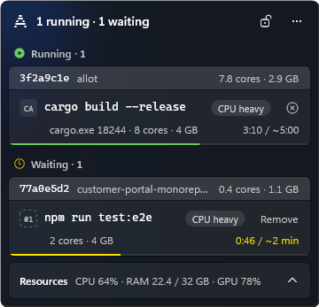
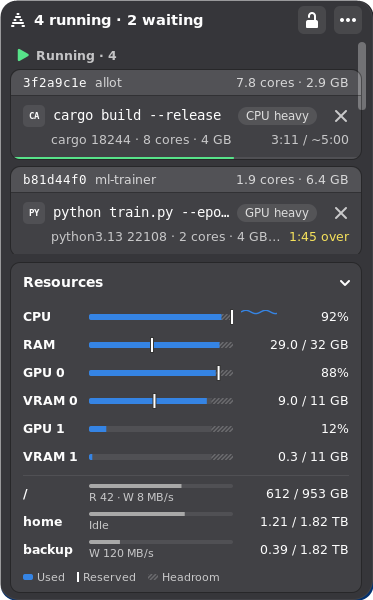

<h1>
  <picture>
    <source media="(prefers-color-scheme: dark)" srcset="assets/brand/png/allot-mark-color-dark-2x.png">
    
  </picture>
  Allot
</h1>

[](https://github.com/meh7an/allot/actions/workflows/ci.yml)
[](https://github.com/meh7an/allot/releases/latest)
[](#license)


Coordinates heavy jobs between the Claude Code sessions on one machine. Sessions ask a small local
daemon for a lease before a build, test suite, benchmark, or training run, and wait their turn when
the machine is busy, instead of all compiling at once.

<p align="center">
  <picture>
    <source media="(prefers-color-scheme: dark)" srcset="docs/images/demo-dark.gif">
    
  </picture>
  <br>
  <sub>A real run: two sessions ask for 8 cores each, and the second starts on what is left.
  Recorded by <a href="docs/demo/record.sh">docs/demo/record.sh</a>.</sub>
</p>

<p align="center">
  
  <br>
  <sub>The Windows panel, showing sample jobs.</sub>
</p>

## Why

Run three or four Claude Code sessions on one machine and they will, sooner or later, all start
`cargo build`, a test suite, or a training run in the same minute. Each job then takes several
times longer, RAM runs out, tool calls time out, and any timing a session measures is noise.
None of the sessions can see the others.

Allot gives them a shared view of the machine and a ledger of who is using what. A session
reserves the cores, RAM, GPU, and VRAM a job needs before running it; when they are not free, it
starts on fewer cores or waits in a queue and is told what is ahead and roughly how long. A job
that ran before reserves what it used then, not what was guessed. Everything stays on your machine.

## Install

All three need Claude Code and no admin rights. On Linux and macOS:

```bash
curl -fsSL https://raw.githubusercontent.com/meh7an/allot/main/install.sh | sh
```

On Windows, in PowerShell:

```powershell
irm https://raw.githubusercontent.com/meh7an/allot/main/install.ps1 | iex
```

The script downloads the latest release for your machine, checks it against its `.sha256`, and
runs `allot install`, which sets up Claude Code and starts allotd at login. Start a new Claude
session afterwards; there is nothing else to set up. [docs/install.md](docs/install.md) has every
option, including pinning a version, and upgrades, uninstalling, and building from source.

### Windows

The script runs the release's setup silently, so Allot is in Apps & features for uninstalling.
To run the setup yourself, download `allot-<version>-setup.exe` from the
[latest release](https://github.com/meh7an/allot/releases/latest). It is not code-signed, so
SmartScreen may ask you to confirm (More info, Run anyway).

### Linux

Needs x86_64 or aarch64 and glibc 2.35 or newer (Ubuntu 22.04, Debian 12, Fedora 36 and later).
The GNOME extension and the KDE widget are separate packages:
[install the panel](docs/install.md#the-panel).

### macOS

Needs Apple Silicon and macOS 14 or newer. Homebrew works too:

```bash
brew tap meh7an/allot
brew trust --tap meh7an/allot
brew install allot
allot install
brew install --cask allot-app    # the menu bar app
```

The menu bar app is a separate package either way. It is signed ad hoc, so macOS stops it once:
System Settings > Privacy & Security then offers Open Anyway.

### npm

On any of these machines, npm works too:

```bash
npm install -g @meh7an/allot
allot install
```

## What a session looks like

Once installed, there is nothing to call by hand. The skill and the CLAUDE.md rule make each session
lease before a heavy command, and a hook stops the ones that forget.

This is a real run of 0.5.0 on a 16-core Windows PC with the default settings. Two sessions, each
with its own `allot-mcp`, ran `cargo build --release` in their own project, and a build script kept
four threads busy for 45 seconds. `cpu_heavy` asks for 8 cores and can start on 4.

The first session got its 8 cores at once. The second asked for 8 too, but after the headroom, the
first lease, and what the rest of the PC was using, 4.7 were free, so it started on those right
away instead of waiting in the queue:

```json
{
  "lease_id": 3,
  "state": "active",
  "kind": "normal",
  "profile": { "cores": 4.7, "ram_mb": 4096, "gpu_pct": 0.0, "vram_mb": 0, "est_secs": 300 },
  "label": "cargo build --release",
  "verdict": { "fits": true, "reasons": ["granted 4.7 of 8.0 cores"], "wait_estimate_secs": null },
  "next_step": "Run the command now, then call release_lease with this lease_id."
}
```

Both builds then ran side by side:

```console
> allot status
allotd 0.5.0 (pid 14500, up 11m 29s)
cpu      63.4% (10s 73.4%, 60s 39.2%) of 16 logical cores
ram     32.0 GB / 63.9 GB, commit 54.1 GB / 85.9 GB
gpu0    NVIDIA GeForce RTX 2080 Ti: busiest engine 3%, vram 2.5 GB / 10.8 GB

sessions
  04bcc2cd  pid 67200   3.96 cores  ram 0.1 GB  gpu   0%  vram 0.0 GB
    lease 2    active   cpu_heavy 8.0 cores, 4.0 GB for 18s  cargo build --release
  ceea41b8  pid 32304   3.96 cores  ram 0.1 GB  gpu   0%  vram 0.0 GB
    lease 3    active   cpu_heavy 4.7 of 8.0 cores, 4.0 GB for 15s  cargo build --release
other               1.64 cores  ram 30.3 GB  gpu   3%  vram 2.5 GB
```

Each session released its lease, and Allot recorded what each build used: under 4 cores and
0.2 GB, far less than it reserved. A run that needs more than its session declares reserves what
earlier runs needed. After three runs of the same command in the same folder, a run that needs
less reserves what they used plus 10%. `api-server` was built three more times, and after its
third run `release_lease` told the session what the next run would reserve:

```json
"next": {
  "profile": { "cores": 4.3, "ram_mb": 256, "gpu_pct": 0.0, "vram_mb": 0, "est_secs": 300 },
  "reasons": [
    "cores 4.3 from p90 of 3 past run(s) plus 10% (declared 8.0)",
    "RAM 256 MB, the floor (the highest peak of 3 past run(s): 160 MB, declared 4096 MB)"
  ]
}
```

The next build got 4.3 cores and 256 MB instead of 8 cores and 4 GB. `allot history` shows the
median, p90, and max of each job:

```console
> allot history
median, p90 and max over the newest runs without an overlapping lease: cores and GPU while busy, peak RAM and VRAM, run time

cargo build --release|c:\users\mehran\allot-sample\api-server
  4 run(s), last ended 0s ago: cargo build --release
  from 4 run(s)   cores      RAM  time
  median            3.9   0.1 GB  47s
  p90               3.9   0.2 GB  47s
  max               3.9   0.2 GB  47s

cargo build --release|c:\users\mehran\allot-sample\web-app
  1 run(s), last ended 2m 23s ago: cargo build --release
  from 1 run(s)   cores      RAM  time
  median            3.8   0.2 GB  47s
  p90               3.8   0.2 GB  47s
  max               3.8   0.2 GB  47s
```

## The panel

A Windows tray app, a macOS menu bar app, a GNOME Shell extension, and a KDE Plasma 6 widget show the
same things: every session's jobs, how long they have left, and what the machine has free.

<p align="center">
  
  <br>
  <sub>The GNOME panel with Resources open, showing sample jobs.</sub>
</p>

**Kill** stops a running job and **Remove** takes a queued one out of the queue, each after asking
once more. Kill ends only the process tree that the lease's command started, never Claude Code
itself. The session is told you stopped the job, and asks you whether to retry or skip. It never
retries on its own.

## Everyday commands

| Command | Shows or does |
|---------|---------------|
| `allot status [--watch]` | Machine usage, sessions, and their leases, once or redrawn every 2 s. Starts allotd if it is down. |
| `allot leases [--all]` | Active and queued leases, or the most recent ones in any state. |
| `allot history [FINGERPRINT]` | Median, p90, and max of what past jobs used, or the runs of one job. |
| `allot classes` | The heavy-command rules, class profiles, and presets in effect. |
| `allot kill ID` / `allot remove ID` | Stop a running job, or take a queued one out of the queue. |
| `allot daemon start\|stop\|status` | Control allotd. `status` never starts it. |
| `allot doctor` | Check the install and say what to fix. Changes nothing. |

`status`, `leases`, `history`, `kill`, `remove`, `daemon status` and `doctor` take `--json`; the
shapes are the JSON Schemas in [`contract/`](contract/). Colour follows `--color`, `NO_COLOR` and
`CLICOLOR_FORCE`, and is off when the output is piped. Shell completions and the man page:
[docs/install.md](docs/install.md#shell-completions-and-the-man-page).

## Configuration

`~/.allot/config.toml` is optional. On Windows `~` is `%USERPROFILE%`. allotd reloads it within 5 s.

```toml
[admission]
headroom_pct = 15          # capacity kept free of leases

[hook]
fail_open = true           # let commands run when allotd is down

[benchmark]
max_quiet_wait_secs = 60   # grant a benchmark without quiet after this long
```

Every key, the class profiles, and the classifier rules are in the
[runbook](docs/runbook.md#configuration).

## Learn more

- [Install guide](docs/install.md): every option, upgrades, uninstalling, and building from source.
- [How it works](docs/how-it-works.md): the parts, admission, learned profiles, benchmarks, files,
  and platform support.
- [Runbook](docs/runbook.md): health checks, stopping jobs, [admission](docs/runbook.md#admission)
  (minimum cores, learned estimates, overruns), crash recovery, and
  [troubleshooting](docs/runbook.md#troubleshooting).
- [Changelog](CHANGELOG.md).

## Contributing

Issues and pull requests are welcome; see [CONTRIBUTING.md](CONTRIBUTING.md). Report security
issues privately as described in [SECURITY.md](SECURITY.md).

## License

Licensed under either of

- Apache License, Version 2.0 ([LICENSE-APACHE](LICENSE-APACHE) or
  <https://www.apache.org/licenses/LICENSE-2.0>)
- MIT license ([LICENSE-MIT](LICENSE-MIT) or <https://opensource.org/licenses/MIT>)

at your option.

Unless you explicitly state otherwise, any contribution intentionally submitted for inclusion
in the work by you, as defined in the Apache-2.0 license, shall be dual licensed as above,
without any additional terms or conditions.
