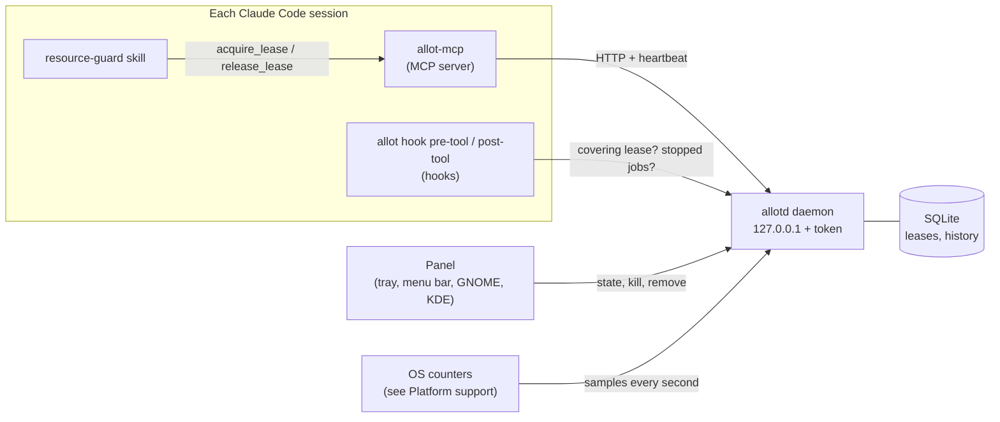

# How Allot works

The parts, what the daemon does with a request, and where each platform differs. For running it
day to day, see the [runbook](runbook.md).

## The parts

| Part | What it does |
|------|--------------|
| `allotd` | The daemon: samples the machine every second, keeps the lease ledger in SQLite, and serves an HTTP API on `127.0.0.1` with a bearer token. No window; it logs to a file. |
| `allot-mcp` | The MCP server each session starts (`allot`): `system_snapshot`, `can_fit`, `acquire_lease`, `release_lease`, `list_leases`. It heartbeats its leases and releases them when the session ends. |
| `allot hook pre-tool` | A PreToolUse hook for the Bash and PowerShell tools. It denies a heavy command when the session holds no covering lease, and lets it through with a warning when allotd is down. |
| `allot hook post-tool` | A PostToolUse and PostToolUseFailure hook that tells the session when you stopped its job. |
| `allot-tray` | The Windows tray app: an icon that shows how busy the machine is, and a flyout with every session's jobs, Kill and Remove, resource meters, and notifications. Only a client of allotd. |
| Menu bar app, GNOME extension, KDE widget | The same for macOS and Linux desktops, also only clients of allotd. |
| `resource-guard` skill | Tells Claude when and how to lease. A CLAUDE.md rule points sessions to it. |
| `allot` | The CLI: status, leases, history, kill, remove, daemon control, install. |

## What the daemon does with a request

- **Admission.** A lease is granted when its profile fits in what the machine has free, keeping
  a headroom (15% by default). Otherwise it queues; smaller jobs may backfill ahead of a
  queued one only when that does not delay it, so nothing starves.
- **Learned profiles.** Every released lease records what the job really used. The next run
  of the same command in the same folder is estimated from that history, not only from what
  the session declared.
- **Benchmarks.** A `benchmark_exclusive` lease drains the machine and waits for it to stay
  quiet before it is granted, so measurements are not disturbed. The background noise during
  the run is recorded on release.
- **Liveness.** Leases are kept alive by heartbeats and tied to the session's process. A
  session that ends or crashes loses its leases within a second or two, so they never leak.
- **Fail-open.** If allotd is down, the hook lets commands run with a warning instead of
  blocking every shell call.

The classes are `light`, `cpu_heavy`, `gpu_heavy`, and `mixed`; timing work adds the lease
kind `benchmark_exclusive`. `allot classes` prints the class profiles and the rules that decide
which commands count as heavy.

## The panel

The Windows tray app, the macOS menu bar app, the GNOME extension, and the KDE widget all show the
same things. The icon shows whether the machine is idle, busy, or has jobs waiting. Click it to
open the panel:

- **Jobs.** Each running or queued job with its process, command, class, time, and estimate;
  a bar fills toward the estimate. Finished and stopped jobs stay for a moment with how they
  ended.
- **Kill** (running jobs) and **Remove** (queued ones) ask once more (Kill?) before they act.
  Kill ends only the process tree the lease's command started: never Claude Code itself,
  allotd, allot, allot-mcp, or a process older than the command. The lease ends and its session is
  told that you stopped the job, so Claude says so and asks you whether to retry or skip; it
  never retries on its own.
- **Benchmarks** show their phase: draining the machine, waiting for quiet, running alone.
- **Resources** (More options, Meters) shows CPU, RAM, GPU, VRAM, and drives, with what is
  used, reserved by leases, and free.
- **Notifications** for a stopped service, a job running well past its estimate, finished jobs,
  and jobs stopped from outside the panel; each can be turned off under More options.
- **Pin** keeps the panel up.

On Windows, **Stay open** keeps the flyout up too and a pinned flyout can be dragged. The tray menu
starts and stops allotd and turns Launch at logon on or off (it is also listed in Task Manager's
Startup apps as Allot). Stop service only lasts until a session's `allot-mcp` needs allotd again
and starts it.

## Files

All under `%USERPROFILE%\.allot\`, or `~/.allot` on Linux and macOS, which have no `bin/tray/` and
keep the panel's settings in `tray.json` too. On Windows it is not under `AppData` because the
Claude desktop app is MSIX-packaged and Windows redirects its writes to `AppData` into a folder that
terminal sessions cannot see.

| Path | Contents |
|------|----------|
| `bin\` | `allot.exe`, `allotd.exe`, `allot-mcp.exe` |
| `bin\tray\` | The tray app, `allot-tray.exe` and its runtime. |
| `config.toml` | Optional overrides of the defaults. allotd reloads it within 5 s. |
| `allot.db` | Leases, their audit trail, and job history (SQLite, WAL). |
| `token` | The bearer token clients send to allotd. |
| `tray.json` | The panel's settings: meters, notifications, first run. |
| `logs\allotd.log` | The daemon log, rotated at 10 MB, five files kept. |
| `logs\tray.log` | The tray app's log. |

In `~/.claude/`, the install writes `skills/resource-guard/SKILL.md` and `allot.md`
(the rule CLAUDE.md imports), and adds its entries to `settings.json` and `CLAUDE.md`.

## Platform support

Windows 10 and 11 on x86_64: the sampler reads Windows performance counters (PDH) and DXGI for
vendor-neutral GPU and VRAM usage, autostart uses a Windows logon task and the Run key, and the
tray app is a WinUI 3 app. GPU numbers cover one adapter.

Linux on x86_64 and aarch64 with glibc 2.35 or newer: the sampler reads `/proc` and sysfs, and
NVML or DRM for the GPU, autostart is a systemd user unit, and jobs run in cgroup v2 scopes where
systemd allows it. The panel is a GNOME Shell extension or a KDE Plasma 6 widget.

macOS 14 or newer on Apple Silicon: the sampler reads the Mach VM statistics and memory pressure
level, and IOKit for the GPU and drives (per-process GPU figures are estimates), autostart is a
LaunchAgent, and the panel is a menu bar app. Memory is shared with the GPU, so video memory
counts against RAM. The app is signed ad hoc.
